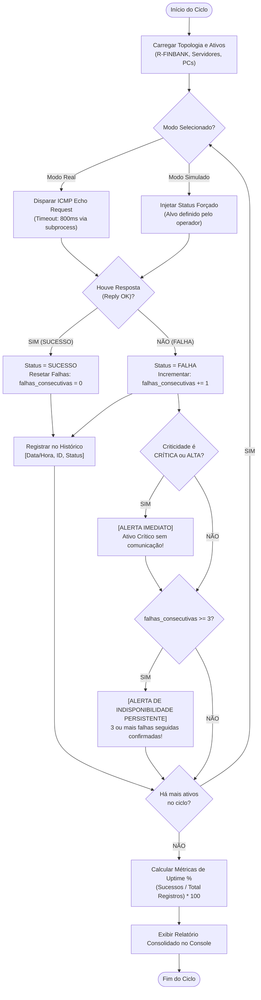
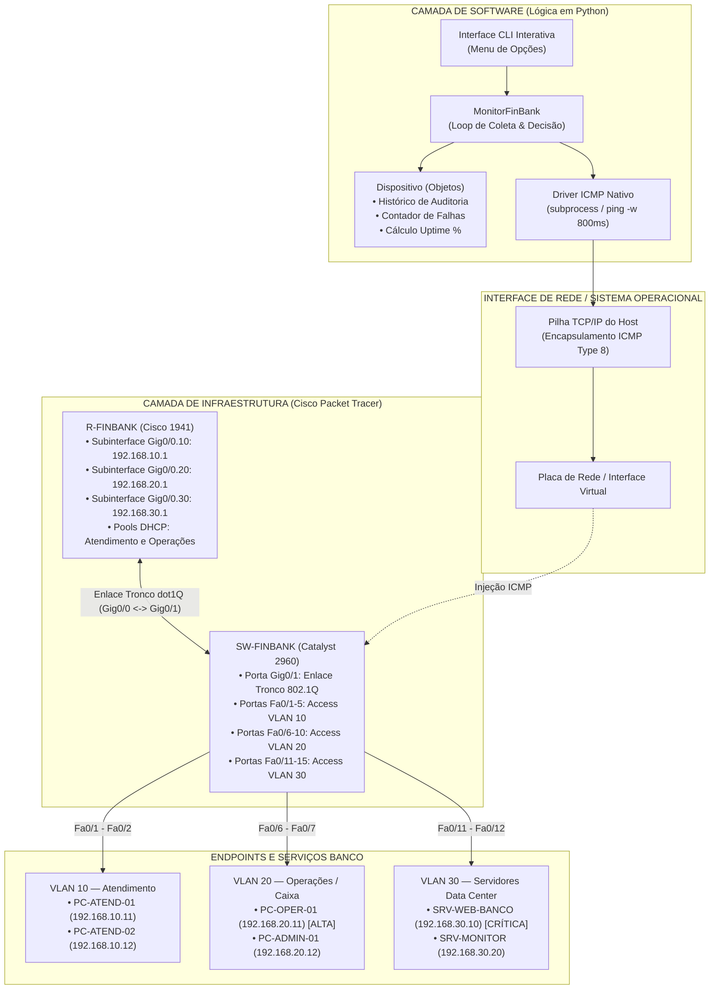

# PROJETO 02 — FINBANK DIGITAL: INFRAESTRUTURA E MONITORAMENTO DE REDE

---

# TÓPICO 2: MODELAGEM DA SOLUÇÃO TÉCNICA
**Sistema de Software de Monitoramento de Rede em Python & Integração de Infraestrutura**

---

## 2.1 Visão Geral da Modelagem

A solução técnica do **FinBank Digital** combina uma infraestrutura física e lógica segmentada em redes locais virtuais (VLANs) sob o padrão *Router-on-a-Stick* e um sistema de software em **Python 3** orientado a objetos. O software atua como a camada de inteligência e diagnóstico operacional da rede bancária, executando verificações ativas de conectividade, calculando métricas de disponibilidade acumulada e aplicando regras de negócio para mitigação de falsos positivos e escalonamento de alarmes críticos.

---

## 2.2 Fluxograma do Algoritmo de Monitoramento

O algoritmo opera sob um ciclo de varredura ativa e tratamento de exceções. O fluxo de decisão compreende o teste de conectividade, a atualização dos contadores de falhas consecutivas, a avaliação da matriz de criticidade do ativo e o disparo de alertas estruturados.

### 2.2.1 Diagrama de Fluxo Lógico (Mermaid)



### 2.2.2 Fluxograma Estruturado em Bloco de Decisão (ASCII)

```
 [ INÍCIO DO CICLO ]
          |
          v
 [ Carregar Lista de Ativos Cadastrados (RF01) ]
          |
          v
 +-------------------------------------------------------------------------+
 | Para cada Dispositivo cadastrado na Topologia:                          |
 |                                                                         |
 |   1. Enviar pacote ICMP Echo Request (Timeout = 800ms)                  |
 |                                                                         |
 |   2. Teste: O host respondeu ao comando ping?                           |
 |      ├── SIM (SUCESSO)                                                  |
 |      │     ├── Status = 'SUCESSO'                                       |
 |      │     └── Resetar contador: falhas_consecutivas = 0 (RN03)         |
 |      │                                                                  |
 |      └── NÃO (FALHA)                                                    |
 |            ├── Status = 'FALHA'                                         |
 |            ├── Incrementar contador: falhas_consecutivas += 1           |
 |            ├── Teste: Criticidade é CRÍTICO ou ALTA? (RN01)             |
 |            │     └── SIM: Emitir [ALERTA DE PRIORIDADE MÁXIMA]          |
 |            └── Teste: falhas_consecutivas >= 3? (RN02)                  |
 |                  └── SIM: Emitir [ALERTA DE INDISPONIBILIDADE]          |
 |                                                                         |
 |   3. Inserir registro cronológico no histórico:                         |
 |      { data: timestamp_atual, status: resultado } (RN04)                 |
 +-------------------------------------------------------------------------+
          |
          v
 [ Calcular Uptime % de todos os ativos: (Sucessos / Total) * 100 ] (RF05)
          |
          v
 [ Gerar Relatório Consolidado e Atualizar Indicadores ] (RF06)
          |
          v
  [ FIM DO CICLO ]
```

---

## 2.3 Pseudocódigo das Principais Funcionalidades

O pseudocódigo a seguir formaliza as regras de negócio e os requisitos funcionais implementados no código Python (`monitor_finbank.py`).

### 2.3.1 Módulo 1: Modelagem de Dados e Cadastro de Dispositivo (RF01)

```pascal
ALGORITMO CadastroDeAtivos
ESTRUTURA RegistroVerificacao:
    data_hora : TEXTO
    resultado : TEXTO // "SUCESSO" ou "FALHA"
FIM_ESTRUTURA

CLASSE Dispositivo:
    ATRIBUTOS:
        id : TEXTO
        nome : TEXTO
        ip : TEXTO
        setor : TEXTO
        servico : TEXTO
        criticidade : TEXTO // "CRITICO", "ALTA", "NORMAL"
        historico : LISTA DE RegistroVerificacao
        falhas_consecutivas : INTEIRO

    MÉTODO Inicializar(id_d, nome_d, ip_d, setor_d, servico_d, criticidade_d):
        id <- id_d
        nome <- nome_d
        ip <- ip_d
        setor <- setor_d
        servico <- servico_d
        criticidade <- MAIUSCULO(criticidade_d)
        historico <- LISTA_VAZIA()
        falhas_consecutivas <- 0
    FIM_MÉTODO
FIM_CLASSE
```

### 2.3.2 Módulo 2: Verificação ICMP de Baixo Nível (Ping com Timeout)

```pascal
FUNÇÃO ExecutarPingICMP(endereco_ip : TEXTO) RETORNA BOOLEANO:
    // RNF01: Timeout máximo de 800ms
    // RNF02: Detecção de sistema operacional para portabilidade
    SE SistemaOperacional() = "WINDOWS" ENTÃO
        comando <- ["ping", "-n", "1", "-w", "800", endereco_ip]
    SENÃO
        comando <- ["ping", "-c", "1", "-W", "1", endereco_ip]
    FIM_SE

    TENTE
        codigo_retorno <- ExecutarProcessoOculto(comando)
        SE codigo_retorno = 0 ENTÃO
            RETORNE VERDADEIRO // Pacote eco respondido com sucesso
        SENÃO
            RETORNE FALSO      // Host inalcançável ou timeout
        FIM_SE
    EXCEÇÃO
        RETORNE FALSO
    FIM_TENTE
FIM_FUNÇÃO
```

### 2.3.3 Módulo 3: Ciclo de Verificação, Auditoria e Regras de Alerta (RF02, RF04, RN01, RN02, RN03, RN04)

```pascal
PROCEDIMENTO ExecutarCicloDeMonitoramento(simular : BOOLEANO, id_falha : TEXTO):
    IMPRIMIR("=================================================================")
    IMPRIMIR("INICIANDO CICLO DE VERIFICAÇÃO DE DISPONIBILIDADE")
    IMPRIMIR("=================================================================")

    PARA CADA disp EM lista_dispositivos FAÇA:
        // 1. Determinação do status de conectividade
        SE simular = VERDADEIRO ENTÃO
            SE disp.id = id_falha ENTÃO
                status_comunicacao <- FALSO
            SENÃO
                status_comunicacao <- VERDADEIRO
            FIM_SE
        SENÃO
            status_comunicacao <- ExecutarPingICMP(disp.ip)
        FIM_SE

        // 2. Registro no histórico cronológico (RF02 e RN04)
        registro.data_hora <- ObterDataHoraAtual()
        SE status_comunicacao = VERDADEIRO ENTÃO
            registro.resultado <- "SUCESSO"
            disp.falhas_consecutivas <- 0 // Reset de contador (RN03)
            status_visual <- "ONLINE [OK]"
        SENÃO
            registro.resultado <- "FALHA"
            disp.falhas_consecutivas <- disp.falhas_consecutivas + 1 // Acumulador (RF04)
            status_visual <- "OFFLINE [FALHA]"
        FIM_SE
        AdicionarAoHistorico(disp.historico, registro)

        IMPRIMIR("[" + disp.criticidade + "] " + disp.nome + " (" + disp.ip + ") -> " + status_visual)

        // 3. Aplicação de Regras de Negócio de Alerta
        SE status_comunicacao = FALSO ENTÃO
            // RN01: Prioridade Máxima para ativos Críticos ou de Alta relevância
            SE disp.criticidade = "CRITICO" OU disp.criticidade = "ALTA" ENTÃO
                IMPRIMIR("  >>> [ALERTA DE PRIORIDADE MÁXIMA] Ativo CRÍTICO sem resposta: " + disp.nome)
            FIM_SE

            // RN02: Detecção de Indisponibilidade Persistente (Regra das 3 Falhas)
            SE disp.falhas_consecutivas >= 3 ENTÃO
                IMPRIMIR("  >>> [ALERTA DE INDISPONIBILIDADE PERSISTENTE] " + disp.nome + " acumulou " + 
                         ConverterParaTexto(disp.falhas_consecutivas) + " falhas seguidas!")
            FIM_SE
        FIM_SE
    FIM_PARA
FIM_PROCEDIMENTO
```

### 2.3.4 Módulo 4: Cálculo Matemático da Disponibilidade Percentual (RF05)

```pascal
FUNÇÃO CalcularDisponibilidadeUptime(disp : Dispositivo) RETORNA REAL:
    total_registros <- TamanhoLista(disp.historico)
    
    // Se ainda não houve checagens registradas, considera 100%
    SE total_registros = 0 ENTÃO
        RETORNE 100.0
    FIM_SE

    total_sucessos <- 0
    PARA CADA reg EM disp.historico FAÇA:
        SE reg.resultado = "SUCESSO" ENTÃO
            total_sucessos <- total_sucessos + 1
        FIM_SE
    FIM_PARA

    // Aplicação da fórmula matemática padrão
    uptime_percentual <- (total_sucessos / total_registros) * 100.0
    RETORNE Arredondar(uptime_percentual, 2)
FIM_FUNÇÃO
```

### 2.3.5 Módulo 5: Emissão de Relatório Consolidado (RF06)

```pascal
PROCEDIMENTO GerarRelatorioConsolidado():
    IMPRIMIR("=================================================================================")
    IMPRIMIR("RELATÓRIO CONSOLIDADO DE DISPONIBILIDADE - FINBANK DIGITAL")
    IMPRIMIR("=================================================================================")
    IMPRIMIR("ID    | DISPOSITIVO      | SETOR          | CRITICIDADE | UPTIME % | ESTADO FALHAS")
    IMPRIMIR("---------------------------------------------------------------------------------")
    
    PARA CADA disp EM lista_dispositivos FAÇA:
        uptime <- CalcularDisponibilidadeUptime(disp)
        
        SE disp.falhas_consecutivas >= 3 ENTÃO
            estado_falhas <- "PERSISTENTE (" + ConverterParaTexto(disp.falhas_consecutivas) + " falhas)"
        SENÃO SE disp.falhas_consecutivas > 0 ENTÃO
            estado_falhas <- "Intermitente (" + ConverterParaTexto(disp.falhas_consecutivas) + " falha)"
        SENÃO
            estado_falhas <- "Estável (0 falhas)"
        FIM_SE
        
        IMPRIMIR(disp.id + " | " + disp.nome + " | " + disp.setor + " | " + 
                 disp.criticidade + " | " + ConverterParaTexto(uptime) + "% | " + estado_falhas)
    FIM_PARA
    IMPRIMIR("=================================================================================")
FIM_PROCEDIMENTO
```

---

## 2.4 Diagrama Simplificado da Arquitetura da Solução

O diagrama a seguir demonstra a segregação entre a camada de aplicação/software (Python) e a camada física e lógica da rede (Cisco Packet Tracer).

### 2.4.1 Diagrama de Integração Arquitetural (Mermaid)



### 2.4.2 Diagrama Arquitetural Esquemático (ASCII)

```
==============================================================================================
               CAMADA DE SOFTWARE: SISTEMA DE MONITORAMENTO EM PYTHON 3
==============================================================================================
   +---------------------------------------------------------------------------------------+
   |  MonitorFinBank (Classe Central de Controle)                                          |
   |  • Cadastro em Memória (RF01)        • Histórico de Auditoria Imutável (RF02/RF03)    |
   |  • Driver de Ping ICMP (RNF01/02)    • Algoritmo de 3 Falhas Persistentes (RF04/RN02) |
   |  • Matriz de Criticidade (RN01)      • Motor de Cálculo de Uptime % (RF05)            |
   +---------------------------------------------------------------------------------------+
                                              |
                        Geração de Pacotes ICMP Echo (Type 8)
                        Timeout: 800ms por requisição
                                              v
==============================================================================================
         CAMADA DE INFRAESTRUTURA DE REDE FISICA & LÓGICA (Cisco Packet Tracer)
==============================================================================================
                                 +-----------------------+
                                 |       R-FINBANK       |  (Roteador Cisco 1941)
                                 |  Gateway Inter-VLAN   |  Subinterfaces: .10.1 / .20.1 / .30.1
                                 +-----------+-----------+  Servidor DHCP Pools
                                             |
                                             | Enlace Tronco IEEE 802.1Q (Gig0/0 a Gig0/1)
                                             | Pacotes tagueados transportam VLANs 10, 20 e 30
                                             |
                                 +-----------+-----------+
                                 |      SW-FINBANK       |  (Switch Catalyst 2960-24TT)
                                 |  Comutação Camada 2   |  PortFast ativado nas portas de acesso
                                 +-----+-----+-----+-----+
                                       |     |     |
              +------------------------+     |     +-------------------------+
              |                              |                               |
       Portas Fa0/1 - Fa0/2           Portas Fa0/6 - Fa0/7           Portas Fa0/11 - Fa0/12
       VLAN 10 (Access)               VLAN 20 (Access)               VLAN 30 (Access)
              |                              |                               |
              v                              v                               v
    +--------------------+        +--------------------+          +--------------------+
    | SETOR ATENDIMENTO  |        | OPERAÇÕES & CAIXA  |          | SERVIDORES INTERNOS|
    |  PC-ATEND-01 (.11) |        |  PC-OPER-01 (.11)  |          |  SRV-WEB-BANCO(.10)|
    |  PC-ATEND-02 (.12) |        |  PC-ADMIN-01 (.12) |          |  SRV-MONITOR (.20) |
    +--------------------+        +--------------------+          +--------------------+
```

---

## 2.5 Descrição da Integração entre o Algoritmo e a Infraestrutura

A integração entre o algoritmo em Python e a infraestrutura de redes opera por meio da interação entre o espaço de usuário do sistema operacional e a pilha de protocolos de comunicação TCP/IP. Essa sinergia desdobra-se nas seguintes etapas fundamentais:

### 1. Injeção e Despacho de Pacotes ICMP pelo Algoritmo
O método `ping_host(ip)` não depende de sockets raw que requeiram privilégios administrativos elevados no sistema operacional anfitrião. Em vez disso, ele utiliza a biblioteca nativa `subprocess` do Python para disparar o utilitário nativo `ping` do sistema operacional:
* No **Windows**, o comando executado é `ping -n 1 -w 800 <IP_DESTINO>`, onde `-n 1` especifica um único pacote de solicitação de eco (Echo Request) e `-w 800` define a janela de tolerância de tempo limite em **800 milissegundos**.
* No **Linux**, o comando é chaveado automaticamente para `ping -c 1 -W 1 <IP_DESTINO>`.
* O encerramento do processo emite um código de saída (`returncode`). O código `0` indica recebimento do pacote de resposta com sucesso (*Echo Reply* - ICMP Tipo 0). Qualquer código diferente de zero representa estouro de tempo limite (*Request timed out*) ou host inacessível (*Destination host unreachable*).

### 2. Encapsulamento, Segmentação e Roteamento Inter-VLAN (802.1Q)
Quando o pacote ICMP é disparado em direção a um dos endereços da agência (ex.: `192.168.20.11` correspondente ao terminal financeiro `PC-OPER-01`):
1. **Origem:** O pacote ICMP sai do servidor de monitoramento (`SRV-MONITOR`, IP `192.168.30.20`, localizado na VLAN 30).
2. **Encaminhamento ao Gateway:** Por se tratar de um destino em sub-rede distinta (`192.168.20.0/24`), o emissor consulta sua tabela de roteamento e envia o pacote ao seu Gateway Padrão (`192.168.30.1`), que é a subinterface `Gig0/0.30` do roteador `R-FINBANK`.
3. **Trânsito no Switch:** O switch `SW-FINBANK` recebe o quadro na porta de acesso `FastEthernet 0/12` (pertencente à VLAN 30), insere a etiqueta (tag) dot1Q da VLAN 30 e o encaminha através do enlace tronco (`GigabitEthernet 0/1`).
4. **Roteamento Router-on-a-Stick:** O roteador `R-FINBANK` recebe o quadro tagueado na porta física `GigabitEthernet 0/0`, processa-o na subinterface lógica `Gig0/0.30`, remove o cabeçalho 802.1Q da VLAN 30, inspeciona o cabeçalho IP e determina que o destino pertence à sub-rede da subinterface `Gig0/0.20`.
5. **Retagueamento e Entrega:** O roteador encapsula o pacote com a tag da **VLAN 20** e o devolve pelo mesmo enlace tronco ao switch. O switch desassocia o tag 802.1Q e entrega o pacote nativo na porta `FastEthernet 0/6` ao `PC-OPER-01`.
6. **Caminho Reverso (Echo Reply):** O terminal de caixa processa a solicitação e devolve o *Echo Reply* percorrendo o caminho inverso até o software de monitoramento.

### 3. Tratamento de Estados e Regras de Negócio em Tempo Real
A cada resposta recebida pelo algoritmo:
* **Detecção de Queda sem Falsos Positivos:** Se uma porta do switch sofrer microflutuação ou perda pontual de 1 pacote, o status daquele teste será registrado como `FALHA`, mas o alarme de *Indisponibilidade Persistente* não será deflagrado. Apenas se o enlace permanecer rompido por 3 ciclos consecutivos (`falhas_consecutivas >= 3`), a regra **RN02** deflagra o alerta vermelho na console.
* **Escalonamento Prioritário:** Caso o ativo inalcançável seja o roteador `R-FINBANK` ou o servidor `SRV-WEB-BANCO`, a regra **RN01** intercepta a primeira falha e emite imediatamente a mensagem `[ALERTA DE PRIORIDADE MÁXIMA]`, alertando os analistas sobre risco iminente de parada geral do sistema bancário.
* **Auto-Recuperação e Reset:** Quando a conectividade é restabelecida na infraestrutura física (ex.: reativação de porta via `no shutdown`), o próximo teste ICMP retorna êxito, disparando o método que zera o acumulador de falhas seguidas (`falhas_consecutivas = 0`), restabelecendo a operação estável (**RN03**).

### 4. Modo de Simulação Controlada para Testes e Validação
Para permitir demonstrações acadêmicas e validações em laboratório onde a infraestrutura física não esteja conectada fisicamente ao host Python:
* O sistema implementa o parâmetro `simular=True` e `id_falha="SRV01"`.
* O operador pode forçar virtualmente a queda de um ativo específico (ex.: Servidor Web ou Caixa Operacional), comprovando que toda a cadeia de regras de negócio, cálculo de Uptime e relatórios reage com fidelidade idêntica a um rompimento de cabo na topologia do Cisco Packet Tracer.
