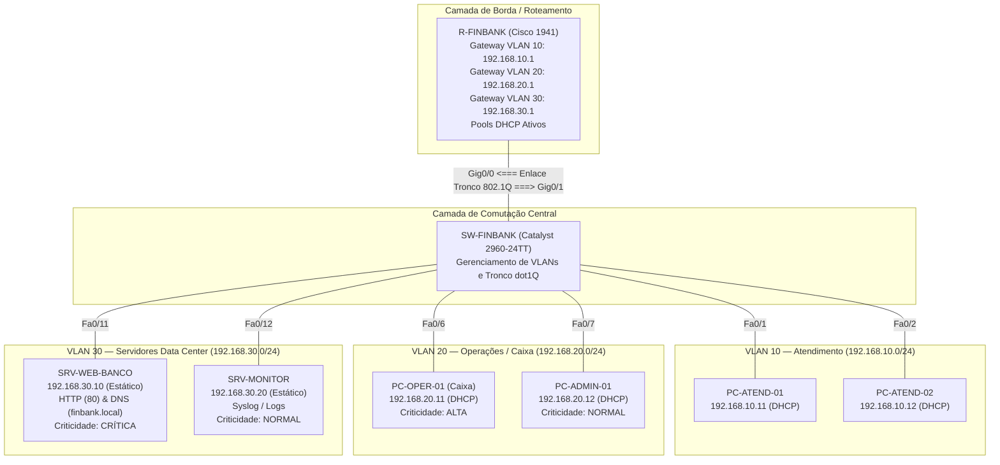

# 🏦 FinBank Digital — Infraestrutura & Monitoramento de Rede

[](https://www.python.org/)
[](https://www.netacad.com/)
[]()
[]()

Projeto prático de **Infraestrutura Corporativa de Redes** e **Software de Monitoramento de Disponibilidade em Tempo Real** desenvolvido para a instituição financeira fictícia **FinBank Digital**.

O projeto adota o modelo corporativo de segregação de funções em duas equipes técnicas:
* **Grupo 01 (Infraestrutura):** Dimensionamento físico, segmentação de VLANs, enlaces tronco 802.1Q, pools DHCP e serviços de aplicação (HTTP, DNS, Syslog) no **Cisco Packet Tracer**.
* **Grupo 02 (Software e Lógica):** Desenvolvimento do sistema de monitoramento em **Python 3**, coleta ativa via ICMP, algoritmo de detecção de indisponibilidade persistente (3 falhas consecutivas) e cálculo de métricas de Uptime %.

---

## 📑 Sumário

1. [Contexto Empresarial e Desafio](#-contexto-empresarial-e-desafio)
2. [Topologia e Arquitetura de Rede](#-topologia-e-arquitetura-de-rede)
3. [Plano de Endereçamento e Criticidade](#-plano-de-endereçamento-e-criticidade)
4. [Regras de Negócio e Algoritmo](#-regras-de-negócio-e-algoritmo)
5. [Estrutura do Repositório](#-estrutura-do-repositório)
6. [Como Executar a Aplicação em Python](#-como-executar-a-aplicação-em-python)
7. [Como Utilizar no Cisco Packet Tracer](#-como-utilizar-no-cisco-packet-tracer)
8. [Documentação Técnica Oficial em PDF](#-documentação-técnica-oficial-em-pdf)
9. [Equipe do Projeto](#-equipe-do-projeto)

---

## 🏢 Contexto Empresarial e Desafio

A **FinBank Digital** opera uma agência física composta por três macrosetores essenciais:
* **Setor de Atendimento ao Cliente (VLAN 10):** Abertura de contas e triagem presencial.
* **Setor de Operações e Administração (VLAN 20):** Terminais de caixas financeiros de alta criticidade e gestão interna.
* **Setor de Servidores e Data Center (VLAN 30):** Servidores centrais de aplicação bancária (Web HTTP), resolução de nomes (DNS) e auditoria (Syslog).

### O Desafio Resolvido
Eliminar o modelo reativo de TI e a ausência de segmentação de rede, implantando uma topologia isolada por VLANs e um software ativo capaz de diferenciar ruídos passageiros de panes persistentes, priorizando imediatamente os ativos que sustentam as operações financeiras.

---

## 📐 Topologia e Arquitetura de Rede

A solução emprega o padrão de arquitetura **Router-on-a-Stick**, utilizando um enlace tronco **IEEE 802.1Q** entre o switch central e o roteador de borda.



---

## 📊 Plano de Endereçamento e Criticidade

| Ativo | Interface Física | Endereço IP | Gateway | VLAN / Setor | Criticidade | Serviço / Função |
| :--- | :--- | :--- | :--- | :--- | :--- | :--- |
| **`R-FINBANK`** | Gig0/0.10/.20/.30 | `192.168.10/20/30.1` | *N/A* | Gateway Core | **CRÍTICA** | Roteamento 802.1Q e Servidor DHCP |
| **`SRV-WEB-BANCO`** | FastEthernet 0 | `192.168.30.10` | `192.168.30.1` | VLAN 30 | **CRÍTICA** | Web Banking (Porta 80) e DNS (`finbank.local`) |
| **`SRV-MONITOR`** | FastEthernet 0 | `192.168.30.20` | `192.168.30.1` | VLAN 30 | **NORMAL** | Coletor Syslog / Servidor de Logs |
| **`PC-OPER-01`** | FastEthernet 0 | `192.168.20.11` (DHCP) | `192.168.20.1` | VLAN 20 | **ALTA** | Terminal Financeiro de Caixa Operacional |
| **`PC-ADMIN-01`** | FastEthernet 0 | `192.168.20.12` (DHCP) | `192.168.20.1` | VLAN 20 | **NORMAL** | Estação de Gestão Administrativa |
| **`PC-ATEND-01`** | FastEthernet 0 | `192.168.10.11` (DHCP) | `192.168.10.1` | VLAN 10 | **NORMAL** | Estação de Atendimento ao Cliente |
| **`PC-ATEND-02`** | FastEthernet 0 | `192.168.10.12` (DHCP) | `192.168.10.1` | VLAN 10 | **NORMAL** | Estação de Atendimento ao Cliente |

---

## ⚙️ Regras de Negócio e Algoritmo

* **RN01 — Matriz de Criticidade:** Ativos classificados como **CRÍTICO** ou **ALTA** disparam avisos imediatos de emergência `[ALERTA DE PRIORIDADE MÁXIMA]` no primeiro insucesso.
* **RN02 — Indisponibilidade Persistente (Regra das 3 Falhas):** Uma parada total só é declarada após **3 checagens consecutivas sem resposta**, evitando alarmes falsos causados por oscilações temporárias.
* **RN03 — Auto-Recuperação e Reset:** Quando o ativo restabelece comunicação, o contador de falhas consecutivas é imediatamente zerado.
* **RN04 — Imutabilidade de Auditoria:** Todos os testes registram timestamp, IP e status de forma cronológica e inalterável.
* **RN05 — Cálculo de Uptime %:**
  $$\text{Disponibilidade } (\%) = \left(\frac{\text{Total de Sucessos}}{\text{Total de Verificações Registradas}}\right) \times 100$$

---

## 📂 Estrutura do Repositório

```text
finbank-digital/
├── .gitignore                          # Arquivos ignorados pelo Git (cache, bytecode)
├── README.md                           # Guia principal do projeto e documentação geral
├── EVIDENCIAS_TESTES.md                # Registro de todos os testes de rede e saídas do software
├── monitor_finbank.py                  # Código-fonte da aplicação de monitoramento em Python
│
├── cisco_packet_tracer/                # Artefatos da simulação de rede
│   ├── README.md                       # Instruções de montagem e teste no simulador
│   ├── comandos_cisco_ios.txt          # Scripts completos de CLI para Switch e Roteador
│   └── FinBank_Digital_Topologia.pkt   # Arquivo de simulação oficial do Packet Tracer
│
└── docs/                               # Documentação técnica e relatórios executivos em PDF
    ├── FinBank_Digital_Documentacao_Tecnica.pdf  # Tópico 1: Documentação Técnica completa
    ├── FinBank_Digital_Modelagem_Solucao.pdf     # Tópico 2: Modelagem, Pseudocódigo e Arquitetura
    ├── FinBank_Digital_Relatorio_Final.pdf       # Relatório Técnico Consolidado de Infraestrutura
    ├── 1_DOCUMENTACAO_TECNICA.md                 # Versão Markdown do Tópico 1
    ├── 2_MODELAGEM_DA_SOLUCAO.md                 # Versão Markdown do Tópico 2
    ├── apresentacao.html                         # Apresentação visual interativa em HTML/CSS
    └── documento_imprimir.html                   # Página formatada para impressão direta
```

---

## 💻 Como Executar a Aplicação em Python

O software foi desenvolvido sem dependências externas, utilizando exclusivamente módulos nativos da biblioteca padrão do Python (`subprocess`, `platform`, `datetime`, `time`).

### Pré-requisitos:
* Python 3.8 ou superior instalado.

### Executando o Monitor:
```bash
# 1. Clone ou acesse o repositório
cd finbank_digital

# 2. Execute o software
python monitor_finbank.py
```

### Menu Interativo:
```text
==============================================
   FINBANK DIGITAL - MONITOR DE REDE
==============================================
1. Executar Verificação Real (Ping na Rede)
2. Simular Verificação com Falha (Teste de Alerta)
3. Consultar Histórico por Equipamento (RF03)
4. Exibir Relatório e Disponibilidade % (RF05/RF06)
5. Cadastrar Novo Dispositivo (RF01)
0. Sair
```

* **Opção 1:** Dispara pings reais ICMP contra todos os IPs da tabela.
* **Opção 2:** Permite forçar uma falha em qualquer ID (ex: `SRV01` ou `R01`) para demonstrar o alarme de 3 falhas persistentes sem desligar o hardware.
* **Opção 4:** Gera a tabela consolidada com o percentual exato de Uptime de cada ativo.

---

## 🌐 Como Utilizar no Cisco Packet Tracer

1. Abra o arquivo **`cisco_packet_tracer/FinBank_Digital_Topologia.pkt`** no **Cisco Packet Tracer v8.x+**.
2. Caso monte a rede do zero:
   * Posicione 1 Roteador 1941, 1 Switch Catalyst 2960, 2 Servidores e 4 PCs.
   * Conecte as portas conforme detalhado em [`cisco_packet_tracer/README.md`](cisco_packet_tracer/README.md).
   * Cole os scripts de configuração disponíveis em [`cisco_packet_tracer/comandos_cisco_ios.txt`](cisco_packet_tracer/comandos_cisco_ios.txt).
3. No `PC-OPER-01`, abra o navegador e acesse `http://finbank.local`.

---

## 📄 Documentação Técnica Oficial em PDF

Os relatórios técnicos completos e prontos para submissão acadêmica/corporativa encontram-se no diretório [`docs/`](docs/):
* 📘 [FinBank_Digital_Documentacao_Tecnica.pdf](docs/FinBank_Digital_Documentacao_Tecnica.pdf): Requisitos funcionais (RF01 a RF09), não funcionais, escopo, dores e regras de negócio.
* 📙 [FinBank_Digital_Modelagem_Solucao.pdf](docs/FinBank_Digital_Modelagem_Solucao.pdf): Fluxogramas, pseudocódigo estruturado, diagrama de arquitetura e integração ICMP.
* 📗 [FinBank_Digital_Relatorio_Final.pdf](docs/FinBank_Digital_Relatorio_Final.pdf): Relatório consolidado com matriz de testes e registro de troubleshooting.

---

## 👥 Equipe do Projeto

* **Grupo 01 — Infraestrutura de Redes (Cisco Packet Tracer):**
  * **Jamerson Albuquerque** (*Líder Técnico & Infraestrutura Cisco IOS*)
  * Integrantes do Grupo 01
* **Grupo 02 — Software e Lógica de Monitoramento (Python):**
  * Integrantes do Grupo 02
